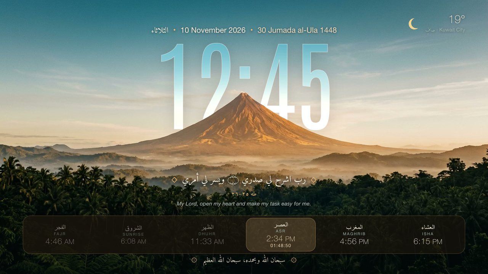

# Noor · نور

An Islamic home dashboard for your TV (Samsung, Android TV, Google TV, Fire TV and LG): prayer times, the Hijri date, a verse of the day,
occasions (Friday, Ramadan, the Eids, Arafah), adhkar and the weather, over full-screen photos.
Arabic and English. It runs on the TV by itself: once it is installed there is no computer, no
server and no account behind it.



| | |
|---|---|
|  |  |

## What it does

- **Prayer times worked out on the TV**, offline, for any place: pick your city from a built-in
  list of about 1,400 cities, or search for any town by name. Seventeen calculation methods (Umm
  al-Qura, Muslim World League, Egypt, Karachi, ISNA, Kuwait, Jordan, Qatar, UAE, Turkey and
  more), chosen from the country and changeable, Standard or Hanafi Asr, and plus or minus minutes
  per prayer to match your mosque.
- **A banner at prayer time**, and a reminder some minutes before if you want one.
- **Hijri date**, with a day's adjustment either way, and **occasions**: Surat al-Kahf on Friday,
  Ramadan with a countdown to iftar, the Eids, the ten days of Dhul-Hijjah, Arafah, the white days.
- **A Quran player**: any of the 114 surahs, from fourteen reciters. When a surah ends the next
  one starts. Favourites, and it remembers where you stopped.
- **Four layouts**: Classic (large clock and the prayer arch), Centered, Ambient, and the
  **Scenery clock**, a big glass clock that sits *behind* the mountains of the photo.
- **Photos that follow the day**: dawn photos at dawn, night photos at night. Add your own.
- **Night mode** after Isha and **idle dimming** after a while with no button pressed.
- Everything is driven by the TV remote: arrows, OK and Back. Coloured buttons are shortcuts
  where a remote has them.

## Put it on your TV

### The easy way: ask an AI coding agent

If you use an AI coding agent (Claude Code, Codex, Cursor and the like), give it this page's
address and say what TV you have:

> Put Noor on my TV: https://github.com/DevMohammadSalameh/noor-tv

The repository carries instructions written for the agent ([AGENTS.md](AGENTS.md)). It does the
computer work, tells you which buttons to press on the remote, and waits while you sign in to
your own accounts. You need no technical knowledge.

### Which TV?

| Your TV | What it takes | Guide | Tried on |
|---|---|---|---|
| **Samsung** (2017 or newer) | A computer on the same Wi-Fi, once. The TV's Developer Mode. Your Samsung account. | [docs/SAMSUNG.md](docs/SAMSUNG.md) | A real 2025 Samsung |
| **Android TV, Google TV, Fire TV** | Nothing but the TV: a free app called Downloader and one web address. Or a computer, if an agent is helping. | [docs/ANDROID-TV.md](docs/ANDROID-TV.md) | An emulator only, not a real TV yet |
| **LG** | A computer once, LG's Developer Mode app, a free LG developer account. LG removes it unless you press Extend every few weeks. | [docs/LG.md](docs/LG.md) | Not tried on any LG yet |
| Roku, Apple TV, Vizio and others | Not supported. A Google TV or Fire TV stick in a spare HDMI port makes any TV an Android one. | | |

Noor is not in any TV's app store, so each of these is the maker's own way of adding an app
yourself. Every guide ends with how to take it off again.

### The files

Each [release](https://github.com/DevMohammadSalameh/noor-tv/releases/latest) carries three, and
these links always give the newest:

- Samsung: [`Noor.wgt`](https://github.com/DevMohammadSalameh/noor-tv/releases/latest/download/Noor.wgt).
  It is unsigned on purpose: a Samsung TV only runs an app signed for that TV, so the install tool
  signs it with your own certificate.
- Android TV, Google TV, Fire TV: [`Noor.apk`](https://github.com/DevMohammadSalameh/noor-tv/releases/latest/download/Noor.apk)
- LG: [`Noor.ipk`](https://github.com/DevMohammadSalameh/noor-tv/releases/latest/download/Noor.ipk)

To build them yourself: `sh scripts/build.sh` (Samsung), `sh scripts/build-android.sh` (Android),
`python3 scripts/build-webos.py` (LG). Each script's first lines say what it needs.

### Opening it when the TV is switched on

On a Samsung: **Settings, General, Smart Features, Autorun Last App**. An Android TV wakes up
where it was left. Each guide has the details. Nothing has to stay running anywhere else.

## First run

The first time Noor opens it asks three things: the language, your city, and the layout. The city
it offers first comes from the TV's time zone. All of it can be changed later in Settings.

## The remote

- Any button shows the **Settings** button. **OK** opens it.
- In Settings: **▲ ▼** move, **OK** opens a section or changes a row, **◀ ▶** change a value,
  **Back** steps back and then saves and closes.
- Any button also shows the **Quran** button beside Settings; **◀ ▶** move between the two.
- On the home, **▲** reaches the buttons on the card. **Play/Pause** and **Stop** on the remote
  work everywhere, as do **⏭ ⏮** (next and previous surah) and **⏩ ⏪** (30 seconds) on remotes
  that have them.
- In the photo grid: **OK** switches a photo on or off, **yellow** keeps only that one, **green**
  switches them all on.
- **Back** on the home returns to the TV's own home.

## Listening to the Quran

Open the **Quran** button on the home, or **All surahs** on the card.

- **OK** on a surah plays it. OK on the one playing pauses it; OK on the one you stopped at carries
  on from that minute.
- **When a surah ends the next one starts**, in the order of the mushaf, and stops after An-Nas.
  The **blue** button (or Settings, General, After a surah) changes that to Stop, Repeat it, or
  Shuffle.
- **Yellow** marks a favourite. **Green** shows only your favourites; played from there, "next"
  stays among them.
- **Red** changes the reciter.
- No coloured buttons on your remote? Press **▲** from the top row of surahs: the same four
  options are along the top of the screen.
- **Back** leaves the list and the recitation carries on. A small bar on the home shows the surah,
  the reciter and how far along it is.
- The home card offers **Continue** where you stopped. On Friday it offers Al-Kahf, after Isha
  Al-Mulk, in Ramadan Al-Baqarah, and on the Eids the takbeer.
- Noor remembers the surah and the minute even after the TV is switched off. Nothing ever starts
  playing by itself.

The recitations are streamed, so this part needs the internet.

## Prayer times, and how far to trust them

The times are calculated on the TV from where your city is and the method chosen, and are usually
within a minute or two of printed timetables. They are a calculation, not your mosque's timetable:
check them against it once, and use **Settings, Prayer, Fine-tune** to move any of them by a few
minutes if they differ.

- Times are shown in **the TV's own time**. If they look an hour out, the TV's clock or time zone
  is wrong (fix it in the TV's own settings).
- Far north or south in summer, when the sky never gets fully dark, Fajr and Isha are placed by
  sharing the night out by the method's angle (the "angle based" rule).
- Umm al-Qura's Isha is 90 minutes after Maghrib all year; the 120 minutes used in Ramadan is not
  applied, so add 30 minutes in Fine-tune for that month if you follow it.

## The scenery clock

Choose **Settings, Look, Scenery clock**. The time is drawn as large glass digits filled with a
blurred copy of the photo. On photos that have a cut-out (marked "clock behind the scenery" in
Settings, Backgrounds) the mountains or hills are drawn again over the clock, so they overlap the
bottom of the digits. On the other photos the clock simply sits over the picture.


Under **Look** you can also choose the glass (**Frosted**, or clear **Liquid** glass that slightly
magnifies what is behind it) and how clear it is, in five steps.

## Your own photos

```sh
python3 -m venv .venv && .venv/bin/pip install numpy Pillow
.venv/bin/python scripts/make-scene.py ~/Pictures/beach.jpg beach --mood day --name "The beach"
```

That writes the photo at 1920x1080, a thumbnail and the glass copy into `img/bg/mine/` and
`img/thumb/mine/`, and prints one line to add to `js/mine.js` (copy `js/mine.example.js` to
`js/mine.js` first). Build and install again and the photo is in Settings, Backgrounds.

Git ignores `js/mine.js` and both `mine` folders, so your photos are never committed or published.
Only the pixels are copied: no EXIF, camera or location data.

**The clock behind your own skyline.** For a photo with open sky above a clear edge (a ridge, a
line of trees, rooftops), add `--depth --preview` (needs `pip install scipy pymatting`). It writes
the cut-out and a check image, `build/scenes/<id>-check.jpg`: open it and look. Magenta should be
exactly where the sky was, and only there. If it is not, leave the cut-out out; the clock over the
photo is fine. `python3 scripts/make-scene.py --help` lists the options for difficult skies.

## What goes over the internet

Noor has no analytics and no server of its own. It makes these requests and no others:

- **Weather**: your city's coordinates go to [Open-Meteo](https://open-meteo.com) every half hour.
- **City search**, only when you use it: the name you type goes to Open-Meteo's geocoding service.
- **Recitations**, only while you listen: the audio streams from mp3quran.net, with
  cdn.islamic.network as a backup for two reciters, and the Eid takbeer from makkahlive.net.

Prayer times, the Hijri date and everything else work with the TV offline.

## Limits to know

- The remote's Home button still opens the TV's own home. Noor is an app, not a replacement for it.
- It is installed outside the app stores, so it does not update itself: install the newer file
  the same way.
- Each TV maker has its own conditions (Samsung's Developer Mode can switch off after a software
  update; LG removes the app unless Developer Mode is extended). The guides say what to expect.
- With the scenery clock the photo stays still (no slow drift), so the cut-out stays lined up.

## Try it in a browser

Noor is plain HTML, CSS and JavaScript with no build step. Serve the folder and open it:

```sh
python3 -m http.server 8000
```

`http://127.0.0.1:8000/index.html` runs it in a browser. Keyboard: arrows, Enter, and Esc for
Back. Handy additions to the address, none of which save anything:
`?fresh=1` (the first-run setup), `?look=scene` (or `classic`, `centered`, `ambient`),
`?bg=scene-night` (one photo), `?lang=en`, `?now=2027-02-20T17:30` (another date and time),
`?open=look` (Settings at a section).

## Where things are

| File | What it holds |
|---|---|
| `js/app.js` | The app: clock, prayers, backgrounds, settings |
| `js/praytimes.js` | The prayer time calculation and the methods |
| `js/occasions.js` | Friday, Ramadan, the Eids and the other occasions |
| `js/content.js` | Verses, adhkar, reciters. Edit freely |
| `js/quran.js` | The 114 surahs: names and ayah counts |
| `js/cities.js` | The bundled cities (generated from GeoNames) |
| `js/backgrounds.js` | The photos, their colours and where the scenery clock sits |
| `scripts/build.sh` | Packs the unsigned Samsung `.wgt`; `--release` packs only what git tracks |
| `scripts/build-android.sh`, `android/` | The Android TV app: one small activity around the same web page |
| `scripts/build-webos.py`, `webos/` | The LG package |
| `scripts/release.sh` | Builds all three for a GitHub release |
| `AGENTS.md`, `docs/` | The install guides, for AI agents and for people |
| `scripts/make-scene.py` | Adds your own photo |
| `scripts/build-cities.py` | Rebuilds `js/cities.js` from GeoNames and Wikidata (its header says how) |

## Credits and licence

Noor's code is under the [MIT licence](LICENSE). The scenery clock and the shape of the settings
screen come from [couch-tv](https://github.com/Seagey/couch-tv) (MIT, Copyright (c) 2026 Seagey),
as do five of the scenes ([NOTICE](NOTICE)). Every photo, font and data source is named with its licence in
[CREDITS.md](CREDITS.md).
