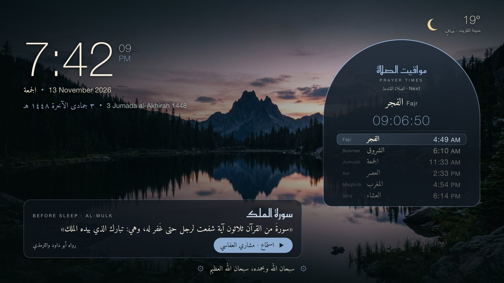
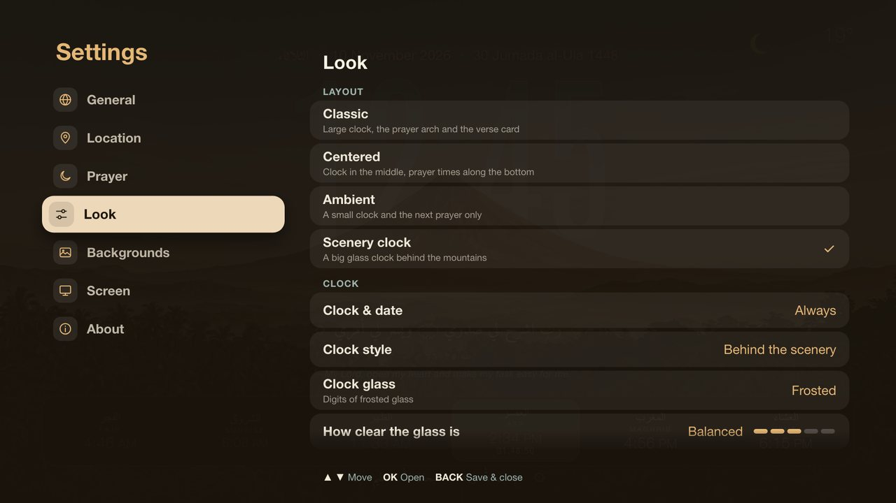
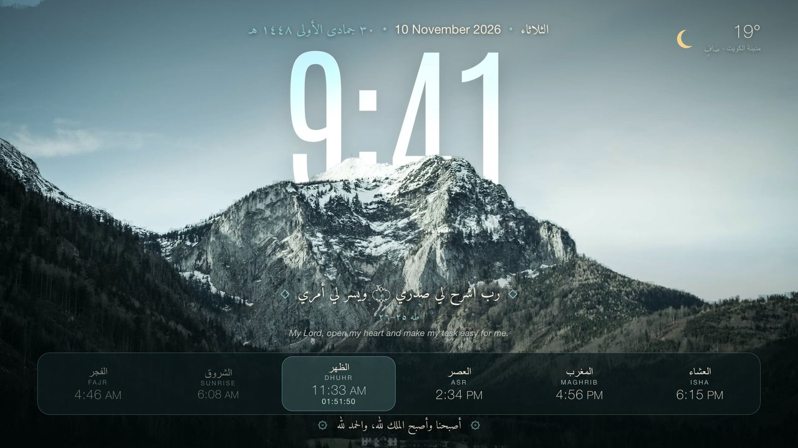

# Noor · نور

An Islamic home dashboard for Samsung TVs: prayer times, the Hijri date, a verse of the day,
occasions (Friday, Ramadan, the Eids, Arafah), adhkar and the weather, over full-screen photos.
Arabic and English. It runs on the TV by itself: once it is installed there is no computer, no
server and no account behind it.


| | |
|---|---|
|  |  |

## What it does

- **Prayer times worked out on the TV**, offline, for any place: pick your city from a built-in
  list of about 1,400 cities, or search for any town by name. Seventeen calculation methods (Umm
  al-Qura, Muslim World League, Egypt, Karachi, ISNA, Kuwait, Jordan, Qatar, UAE, Turkey and
  more), chosen from the country and changeable, Standard or Hanafi Asr, and plus or minus minutes
  per prayer to match your mosque.
- **A banner at prayer time**, and a reminder some minutes before if you want one.
- **Hijri date**, with a day's adjustment either way, and **occasions**: Surat al-Kahf on Friday,
  Ramadan with a countdown to iftar, the Eids, the ten days of Dhul-Hijjah, Arafah, the white days.
  Recitations stream when you press play.
- **Four layouts**: Classic (large clock and the prayer arch), Centered, Ambient, and the
  **Scenery clock**, a big glass clock that sits *behind* the mountains of the photo.
- **Photos that follow the day**: dawn photos at dawn, night photos at night. Add your own.
- **Night mode** after Isha and **idle dimming** after a while with no button pressed.
- Everything is driven by the TV remote: arrows, OK, Back and the colour keys.

## What you need

- A Samsung smart TV (Tizen). Noor is written to run on 2017 and newer models, but so far it has
  **only been run on one TV**, a 2025 Crystal UHD (U8000F, Tizen 9.0). If you try another, an issue
  saying how it went is welcome.
- A computer **once**, to put the app on the TV (Mac, Windows or Linux). After that the TV needs
  nothing else.
- A Samsung account, the one you may already use on the TV. You sign in once on the computer so
  the app can be signed for *your* TV.

Noor is not in Samsung's app store. You install it yourself in the TV's Developer Mode, which
Samsung provides for exactly this.

## Install it on your TV

### 1. Developer Mode on the TV

1. On the TV open **Apps**.
2. Press **1 2 3 4 5** on the remote. With the small remote, use the on-screen number pad. On
   2022 and newer TVs, if nothing happens, scroll to the bottom of the Apps screen and open **App
   Settings**: the code box opens from there.
3. Switch **Developer mode** to **On** and type the **IP address of your computer** (on a Mac:
   System Settings, Wi-Fi, Details). Type each group as it is, with no leading zeros.
4. **Restart the TV**: hold the power button until the Samsung logo appears. A short press only
   sends it to standby.

### 2. Get the package

Download `Noor-<version>.wgt` from this repository's **Releases** page, or build it yourself:

```sh
sh scripts/build.sh
```

That makes `dist/Noor-<version>.wgt`. It is a plain zip of this folder with nothing compiled.

**The package is unsigned, on purpose.** A Samsung TV only runs an app signed with a certificate
made for that TV, so a package signed by someone else would not install on yours. The next step
signs it with your own.

### 3. Install it with Apps2Samsung

[Apps2Samsung](https://github.com/Apps2Samsung/Apps2Samsung/releases) is a free tool that signs a
`.wgt` with **your own** Samsung certificate and installs it. Samsung's Tizen Studio does the same
job if you already have it.

With the desktop app: pick your TV, choose **Custom .wgt**, pick the Noor package, press Install.

Or with its command line:

```sh
apps2samsung-cli tv <tv address>
```

It should say the TV is ready, Developer mode on, with your computer's address as the host. Then:

```sh
apps2samsung-cli install dist/Noor-1.7.0.wgt --tv <tv address>
```

The first time, a browser opens for the Samsung account sign-in. The tool turns that into a
certificate for your TV and keeps it on your computer; later installs need no sign-in. Noor never
sees your password.

**Noor** then appears among the TV's apps. Move it to the front of the app row if you like.

### 4. Open it when the TV is switched on

On the TV: **Settings, General, Smart Features, Autorun Last App**, on. When Noor was the last
app open, the TV starts on it. This is Samsung's own setting, so nothing has to stay running
anywhere else.

## First run

The first time Noor opens it asks three things: the language, your city, and the layout. The city
it offers first comes from the TV's time zone. All of it can be changed later in Settings.

## The remote

- Any button shows the **Settings** button. **OK** opens it.
- In Settings: **▲ ▼** move, **OK** opens a section or changes a row, **◀ ▶** change a value,
  **Back** steps back and then saves and closes.
- On the home, **▲** reaches the play button on an occasion card. **Play/Pause** and **Stop** on
  the remote work too.
- In the photo grid: **OK** switches a photo on or off, **yellow** keeps only that one, **green**
  switches them all on.
- **Back** on the home returns to Samsung's own home.

## Prayer times, and how far to trust them

The times are calculated on the TV from where your city is and the method chosen, and are usually
within a minute or two of printed timetables. They are a calculation, not your mosque's timetable:
check them against it once, and use **Settings, Prayer, Fine-tune** to move any of them by a few
minutes if they differ.

- Times are shown in **the TV's own time**. If they look an hour out, the TV's clock or time zone
  is wrong (fix it in the TV's own settings).
- Far north or south in summer, when the sky never gets fully dark, Fajr and Isha are placed by
  sharing the night out by the method's angle (the "angle based" rule).
- Umm al-Qura's Isha is 90 minutes after Maghrib all year; the 120 minutes used in Ramadan is not
  applied, so add 30 minutes in Fine-tune for that month if you follow it.

## The scenery clock

Choose **Settings, Look, Scenery clock**. The time is drawn as large glass digits filled with a
blurred copy of the photo. On photos that have a cut-out (marked "clock behind the scenery" in
Settings, Backgrounds) the mountains or hills are drawn again over the clock, so they overlap the
bottom of the digits. On the other photos the clock simply sits over the picture.



Under **Look** you can also choose the glass (**Frosted**, or clear **Liquid** glass that slightly
magnifies what is behind it) and how clear it is, in five steps.

## Your own photos

```sh
python3 -m venv .venv && .venv/bin/pip install numpy Pillow
.venv/bin/python scripts/make-scene.py ~/Pictures/beach.jpg beach --mood day --name "The beach"
```

That writes the photo at 1920x1080, a thumbnail and the glass copy into `img/bg/mine/` and
`img/thumb/mine/`, and prints one line to add to `js/mine.js` (copy `js/mine.example.js` to
`js/mine.js` first). Build and install again and the photo is in Settings, Backgrounds.

Git ignores `js/mine.js` and both `mine` folders, so your photos are never committed or published.
Only the pixels are copied: no EXIF, camera or location data.

**The clock behind your own skyline.** For a photo with open sky above a clear edge (a ridge, a
line of trees, rooftops), add `--depth --preview` (needs `pip install scipy pymatting`). It writes
the cut-out and a check image, `build/scenes/<id>-check.jpg`: open it and look. Magenta should be
exactly where the sky was, and only there. If it is not, leave the cut-out out; the clock over the
photo is fine. `python3 scripts/make-scene.py --help` lists the options for difficult skies.

## What goes over the internet

Noor has no analytics and no server of its own. It makes these requests and no others:

- **Weather**: your city's coordinates go to [Open-Meteo](https://open-meteo.com) every half hour.
- **City search**, only when you use it: the name you type goes to Open-Meteo's geocoding service.
- **Recitations**, only when you press play: the audio streams from mp3quran.net, with
  cdn.islamic.network as a backup, and the Eid takbeer from makkahlive.net.

Prayer times, the Hijri date and everything else work with the TV offline.

## Limits to know

- The remote's Home button still opens Samsung's home. Noor is an app, not a replacement for it.
- **Developer Mode can switch itself off** after a TV software update, and some updates remove
  apps installed this way. Then turn it on again and repeat step 3.
- The certificate Apps2Samsung makes is valid for a year. After that, install again and sign in
  once more.
- With the scenery clock the photo stays still (no slow drift), so the cut-out stays lined up.

## Try it in a browser

Noor is plain HTML, CSS and JavaScript with no build step. Serve the folder and open it:

```sh
python3 -m http.server 8000
```

`http://127.0.0.1:8000/index.html` runs it in a browser. Keyboard: arrows, Enter, and Esc for
Back. Handy additions to the address, none of which save anything:
`?fresh=1` (the first-run setup), `?look=scene` (or `classic`, `centered`, `ambient`),
`?bg=scene-night` (one photo), `?lang=en`, `?now=2027-02-20T17:30` (another date and time),
`?open=look` (Settings at a section).

## Where things are

| File | What it holds |
|---|---|
| `js/app.js` | The app: clock, prayers, backgrounds, settings |
| `js/praytimes.js` | The prayer time calculation and the methods |
| `js/occasions.js` | Friday, Ramadan, the Eids and the other occasions |
| `js/content.js` | Verses, adhkar, reciters. Edit freely |
| `js/cities.js` | The bundled cities (generated from GeoNames) |
| `js/backgrounds.js` | The photos, their colours and where the scenery clock sits |
| `scripts/build.sh` | Packs the unsigned `.wgt`; `--release` packs only what git tracks |
| `scripts/make-scene.py` | Adds your own photo |
| `scripts/build-cities.py` | Rebuilds `js/cities.js` from GeoNames and Wikidata (its header says how) |

## Take it off

```sh
apps2samsung-cli uninstall NoorHome01 --tv <tv address>
```

or on the TV: Apps, Settings (the cog), pick Noor, Delete. To switch Developer Mode off: Apps,
**1 2 3 4 5**, Off, restart the TV. Nothing else on the TV was changed.

## Credits and licence

Noor's code is under the [MIT licence](LICENSE). The scenery clock and the shape of the settings
screen come from [couch-tv](https://github.com/Seagey/couch-tv) (MIT, Copyright (c) 2026 Seagey),
as do five of the scenes. Every photo, font and data source is named with its licence in
[CREDITS.md](CREDITS.md).
